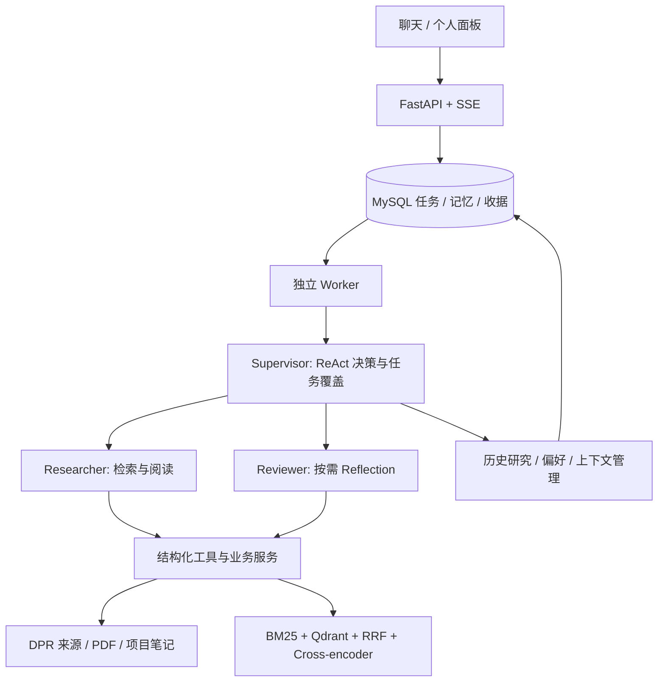

# ResearchLoop

面向个人文献跟踪与课题调研的对话式科研 Agent。本机单用户应用，架构为 **ReAct＋Reflection＋Memory**，使用 **LangGraph** 编排 Supervisor、Researcher、Reviewer。

用户可以用自然语言检索论文、添加链接或 PDF、提出原文问题、生成精读笔记与比较稿。Agent 根据任务选择工具、委派子任务、按需核验；无法完成时保留已有成果并说明缺口。前端提供聊天、个人画像、真实任务进度、原文依据与项目内成果。

## 架构



三个角色使用各自任务、上下文和权限，不表示三套独立训练模型。调用与观察由项目持久化；Checkpoint 是自实现状态快照。仅明确要求精读时调用 DPR 八点总结节点；Reflection 不作为所有回答和保存的统一批准门。

## 状态与边界

- AG0–AG7按约定范围交付，支持本机启动、停止、诊断、冷备与隔离恢复。
- 已补齐：自然语言偏好、对话改名/日期分组、累计 Token 预算、DPR 只读限流退避、聊天阅读清单。
- 已知待修：特定长任务中压缩后的目标/证据读回接续，见 [完善计划](docs/improvement-plan.md)。
- 结构化矩阵保留为实验实现：工程/隔离验证已有，真实模型交付未通过，未作为稳定亮点。
- 检索优化候选出现质量退化，未切换默认路线；现有评测只有6份PDF/24题，不能外推为真实用户效果或大规模泛化。
- 不包含多用户鉴权、公网托管、Obsidian 同步、引用次数排序或任意任务零错误保证。

## 开始使用

依赖：Python 3.14、uv、Node.js/npm、Docker。当前锁文件与本机验证环境不等于所有平台兼容；本地重排冻结权重面向 ARM64。

```bash
git clone https://github.com/CsBillChang/ReasearchLoop.git
cd ReasearchLoop
cp .env.example .env
make sync-index
(cd frontend && npm ci)
make infra
make migrate
```

在本机 `.env` 中填写模型连接信息。论文来源配置与本机向量模型**不随仓库分发**，必须按 [配置与运行手册](docs/delivery.md) 配置；缺失时明确不可用/降级，不冒充完整检索。仓库不附带私人研究数据；首次启动是空白应用。

```bash
make start     # API 18082 / 前端 4173 / Worker / Scheduler
make status
make diagnose  # 不调用生成模型
make stop      # 等待在途调用结算
```

打开 http://127.0.0.1:4173/ 。Scheduler 启动不等于订阅已启用；简报在个人面板配置，默认09:00上海时间、最多5篇候选，不自动精读。

## 开发与证据

```bash
make test      # 默认离线；外部依赖/真实调用测试有显式门控
make check     # Python / JavaScript 语法
```

| 入口 | 内容 |
|---|---|
| [开发完善计划](docs/improvement-plan.md) | P0/P1必做，P2/P3可选；完成、停止与数据扩充边界 |
| [当前状态](docs/status.md) | 唯一当前执行状态 |
| [架构](docs/architecture.md) | 请求链、角色、工具、持久化与授权边界 |
| [文件地图](docs/file-map.md) / [文件清单](docs/code-inventory.md) | 模块职责、全部发布源码/测试/配置/文档 |
| [评测与数据](docs/evaluation.md) | 真实小样本结果、取舍与后续模拟使用方案 |
| [参考与归属](docs/references.md) | 实际复用与仅设计参考分别记录 |
| [发布规则](docs/publication.md) | 上传清单、隐私与本机历史资产边界 |

源码、依赖锁与脱敏结果公开；PDF、模型权重、原始运行轨迹和本机历史文档不公开。真实上游访问和生成模型可能产生费用，测试通过不代表所有来源可用。DPR 复用归属见 [第三方说明](THIRD_PARTY_NOTICES.md)。
