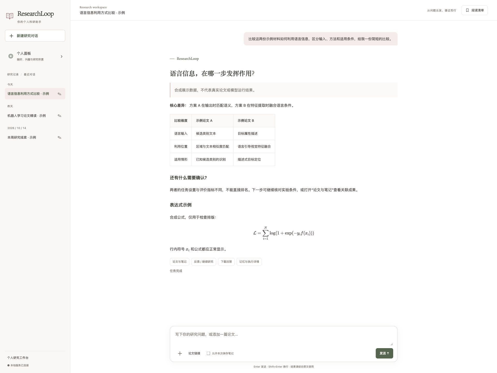
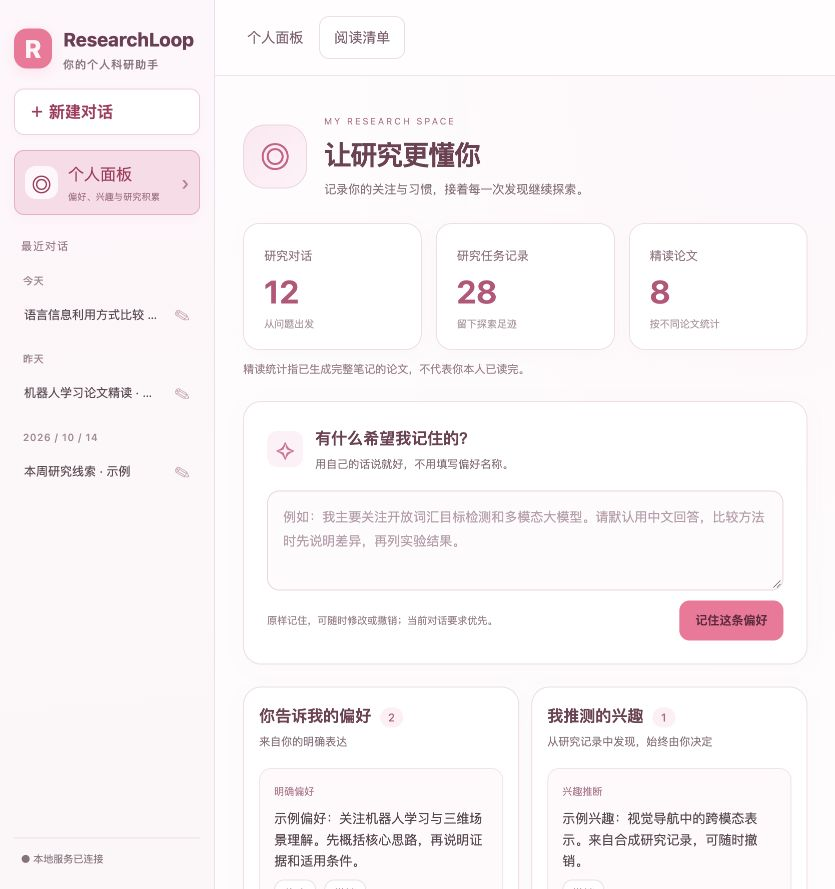
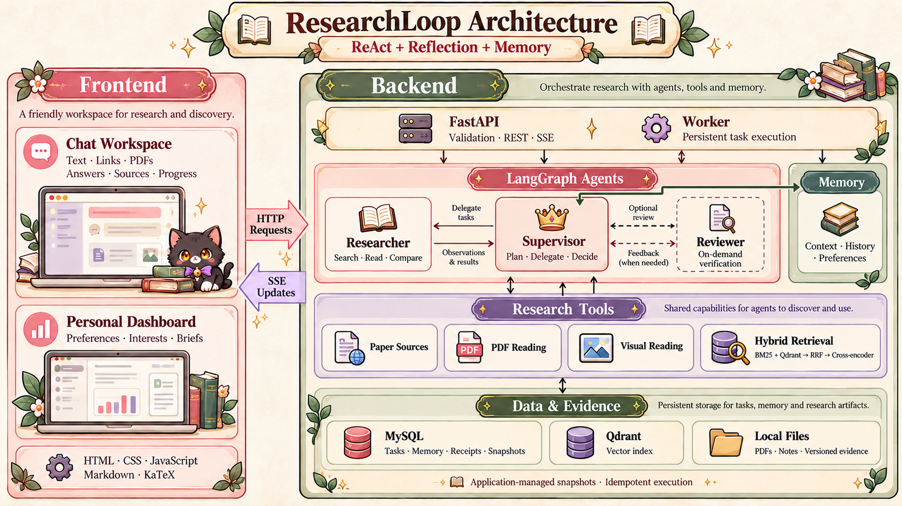

<p align="center">
  
</p>

<h1 align="center">ResearchLoop</h1>
<p align="center"><strong>Research Intelligence &amp; Evidence Reading</strong></p>

<p align="center">
  
  
  
  
  
  
</p>

<p align="center">
  <a href="#preview">Interface Preview</a> ·
  <a href="#features">Core Features</a> ·
  <a href="#architecture">Workflow Architecture</a> ·
  <a href="#evaluation">Evaluation</a> ·
  <a href="#quick-start">Quick Start</a>
</p>

**ResearchLoop** 让你通过对话查找和研读论文、比较研究方法、整理研究笔记，并结合个人兴趣持续跟踪值得关注的研究进展。

<a id="preview"></a>

## Interface Preview

<p align="center">
  
</p>

<p align="center">
  
</p>

<a id="features"></a>

## Core Features

| Feature | Description |
|---|---|
| **论文发现** | 根据研究主题、时间和数量寻找论文；需求不明确时先澄清，不可用的来源会如实说明 |
| **原文问答** | 添加论文链接或上传 PDF，围绕核心方法、实验和公式提问，查看可定位的原文依据 |
| **跨论文比较** | 汇合多篇论文的研究发现，区分方法差异、实验条件、适用范围和资料缺口 |
| **精读与笔记** | 明确要求精读时生成八点笔记，回答、笔记、证据和阅读清单作为聊天成果，按本次授权保存 |
| **按需核验与修订** | 根据具体问题补读原文、核验结论或局部修订；无法确认的部分保留说明并合理结束 |
| **连续研究记忆** | 结合多轮对话、相关研究历史、长期偏好与兴趣线索继续研究，支持上下文压缩后接续 |
| **个性化论文简报** | 按研究方向及已读、曝光记录去重，默认每天 09:00（上海时区）交付最多 5 篇候选，不自动全文精读 |
| **任务进度与历史** | 展示真实进度和回答增量，支持澄清、取消及断线接续；历史对话按日期分组，并可修改名称 |

### Example Requests

> 找两篇近三年的开放词汇目标检测论文，比较它们如何利用语言信息。基于实际读取的原文生成一份简短比较笔记，注明出处和未解决的问题，并保存到项目中。

> 根据我上传的 PDF，解释它的核心方法和实验条件。没有原文支持的细节请直接说明，不要保存文件。

> 以后优先关注开放词汇目标检测和多模态大模型，回答使用中文，比较方法时保留实验条件。

这些是输入示例，任务结果取决于实际取得的材料、已配置的服务和模型输出；未完成的部分会与已有成果一同说明。

<a id="architecture"></a>

## Workflow Architecture

前端提供研究对话与个人面板，通过 HTTP 请求和 SSE 事件与后端连接；后端负责研究任务执行、工具调用、记忆管理和成果持久化。

采用 **ReAct＋Reflection＋Memory** 架构，基于 LangGraph 编排 Supervisor、Researcher 和 Reviewer，通过共享研究状态和独立角色上下文协作；Supervisor 根据目标与观察动态选择路线，不要求每次任务经过全部角色。

<p align="center">
  
</p>

### Agent Roles

| Role | Responsibility |
|---|---|
| **Supervisor** | 理解目标、澄清需求、规划与委派，根据任务覆盖与工具观察调整路线，汇合成果并决定继续或结束 |
| **Researcher** | 使用授权工具检索和读取论文，整理与研究目标相关的发现、原文依据和材料缺口 |
| **Reviewer** | 按需独立核验当前结果，区分支持、反证和缺证，回传具体问题与处理依据 |

角色提示词采用共享原则、角色职责和任务模式按需组合；子任务保留独立目标与材料边界，复用已取得成果，并根据具体证据缺口决定补读、核验或交付。

### Design Principles

- **ReAct**：通过“决策—行动—观察”推进研究，由代码校验工具参数、来源版本、权限和执行边界。
- **Reflection**：按需选择核验、补读或局部修订；结合证据与修订进展决定后续动作，区分工具执行失败和原文缺证，避免无差别重写。
- **Memory**：分离会话上下文、研究历史与长期画像；压缩时保留目标、约束和成果身份，归档材料通过受控工具按需读回。当前要求优先于历史偏好，记忆不继承保存权限。
- **Evidence Retrieval**：原文保留版本、物理页码及内容 hash；在任务授权材料内，通过论文标题与章节定位、通用概念扩展及 BM25 选择候选，再使用 Apple GPU FP16 Cross-encoder 重排。向量索引保留供既有索引与显式旧路线使用。
- **Persistent Execution**：API 与 Worker 分离，通过 SSE 展示进度与回答；MySQL 保存任务、事件、模型收据和项目自实现快照，结合原子领取、租约校验与幂等保存处理并发和中断。成功收据复用，未知请求不盲目重发。

**Tech Stack:** Python / FastAPI / LangGraph / MySQL / Qdrant / ONNX Runtime / PyTorch MPS / JavaScript / Markdown / KaTeX / SSE。

<a id="evaluation"></a>

## Evaluation

### Agent：端到端执行耗时与任务 Token

正式 A/B 基于 **54 篇论文、24 个固定任务、每题每版重复 2 次，共 96 次运行**，比较 V1.5.5 部署等价版本 A 与联合提示词候选 B。B 的设计被 V1.6.0 采用，V1.6.1 继续沿用；以下是历史实验结果，并非对 V1.6.1 重新进行的整套性能测量。

为了在有可用交付的运行间比较成本，从原正式观测中事后筛选出 **双方均至少部分可用的 43 对、覆盖 22 题**。先在每道题内对有效重复取均值，再对题目等权汇总，避免部分题目保留两次、部分仅保留一次导致权重不同。

| 指标（按题等权均值） | A：V1.5.5 部署等价版 | B：联合提示词候选 | 变化 |
|---|---:|---:|---:|
| 端到端执行耗时 | 204.78 秒 | 139.28 秒 | **降低 31.99%** |
| 任务总 Token | 877,351.34 | 503,518.98 | **降低 42.61%** |

端到端执行耗时使用任务运行的墙钟时间，任务总 Token 汇总任务及子任务的实际输入与输出用量。均值可能包含小数；百分比使用未四舍五入的数据计算。

“部分可用”允许提供有依据的已有成果并说明材料或执行限制，样本中包含部分停止的运行，不等同全部完整交付。因此，这组数字描述的是事后可用配对子集，不能解释为全部 96 次的质量等价收益或成功率。工程修复后的补测另行保留，没有回填替换此表中的原始观测。

### RAG：检索质量与本机耗时

在固定 **112 道正样本检索题**上，对比 BM25 与标题/章节定位、通用概念扩展及 FP16 重排路线；另有 2 道缺证题，不计入检索质量分母。热查询每题运行 3 轮，先取题内中位数，再统计题目间 P50/P95：

| 指标 | BM25 | 定位＋FP16 重排 |
|---|---:|---:|
| Recall@10 | 59.82% | **78.13%** |
| MRR@24 | 0.2703 | **0.5400** |
| 本机检索组件热查询 P50 | 39.71 毫秒 | 631.52 毫秒 |
| 本机检索组件热查询 P95 | 56.77 毫秒 | 757.23 毫秒 |

该路线以更多本机计算换取更好的召回与排序，不能表述为相对 BM25 更快。热查询覆盖本机检索组件，不包含在线 SQL/来源授权回读、首次建索引或整个 Agent 的交付；这些耗时也不应与上面的 Agent 端到端执行耗时直接相加或归因。

Reflection 与 Memory 采用有界核验、角色交接和跨会话使用场景的小样本验证；目前不宣称它们各自带来独立的准确率、时延或 Token 百分比收益。原始论文、用户对话、模型响应及实验账本不随公开仓库分发。

<a id="quick-start"></a>

## Quick Start

以下按 **Apple Silicon macOS 的默认 FP16 检索环境**说明。应用在本机运行，MySQL 与 Qdrant 通过 Docker Compose 启动；模型权重、论文来源和 API 凭据需要自行准备。

### 1. 获取源码与安装依赖

需要 Python **3.14**、uv、Node.js/npm 和 Docker Compose v2；先启动 Docker。Python 和前端依赖分别由仓库锁文件管理。若从 GitHub 下载 ZIP，解压后进入项目目录，再从 `cp .env.example .env` 开始执行。

```bash
git clone https://github.com/CsBillChang/ReasearchLoop.git
cd ReasearchLoop

cp .env.example .env
make sync-gpu
npm --prefix frontend ci

mkdir -p data/config
cp config/model-manifest.example.json data/config/model-manifest.json
```

编辑 `.env`，填写 `DEEPSEEK_API_KEY`，并将 `DEEPSEEK_MODEL` 设置为账户实际可用的模型。真实研究任务会调用外部模型接口；API Key 不应提交到 Git。

默认检索需要按 [模型清单模板](config/model-manifest.example.json) 的仓库、revision、文件名和 SHA256 准备本地文件：

| 清单条目 | 用途 | 模板目录 |
|---|---|---|
| `embedding` | multilingual-e5-small 的 ONNX 编码器及分词配置 | `data/local-models/embedding` |
| `reranker` | mmarco-mMiniLMv2-L12-H384-v1 的分词配置及原 ONNX 权重 | `data/local-models/reranker` |
| `reranker_fp16` | 同 revision 的 FP16 重排权重和配置 | `data/local-models/reranker-fp16` |

复制清单不会下载权重。文件目录可自行调整，须与清单一致；相对路径按仓库根目录解释。FP16 路线会复用 `reranker` 条目的 tokenizer/config。准备好文件后，在 `.env` 中添加：

```dotenv
RESEARCHLOOP_RETRIEVAL_MODEL_MANIFEST=data/config/model-manifest.json
RESEARCHLOOP_RETRIEVAL_ROUTE=located_fp16
RESEARCHLOOP_RERANKER_BACKEND=mps_fp16
PYTORCH_ENABLE_MPS_FALLBACK=0
```

模型缺失或不匹配时会显示检索降级，不会自动下载模型或转为 CPU。其他设备可以显式选择 `make sync-index`、`hybrid_rrf` 与 `onnx_cpu`；需要适配对应设备的 ONNX 文件及清单，当前模板的量化重排权重为 ARM64 版本。CPU 路线不代表上述 FP16 实验配置或性能。

### 2. 按需配置论文来源

可以从上传 PDF 开始使用。若要按主题搜索论文或生成来源驱动的简报，需要配置可用的来源服务：

```bash
cp config/paper-sources.example.json data/config/paper-sources.json
```

编辑复制后的文件，填写自己可访问的 Supabase URL、只读凭据和对应 BM25 RPC 名称，并启用所需来源。模板列出 17 个来源适配项，默认全部禁用且连接信息为空，仓库不提供现成论文库或共享凭据。

### 3. Start：初始化并启动

完成前面的 `.env`、模型文件及所需来源配置后，在项目根目录执行：

```bash
# 启动 MySQL、Qdrant，并等待基础设施就绪
docker compose up -d --wait

# 初始化数据库、检查配置，然后启动应用
make migrate
make diagnose
make start
make status
```

日常再次启动使用以下命令，无需重新安装依赖：

```bash
docker compose up -d --wait
make start

# 查看状态 / 停止应用进程
make status
make stop
```

`make start` 一并启动 API、前端、Worker 与 Scheduler。打开 **http://127.0.0.1:4173**，即可从聊天入口提交研究任务。

| 服务 | 默认地址 |
|---|---|
| 前端 | `http://127.0.0.1:4173` |
| API | `http://127.0.0.1:18082` |
| MySQL | `127.0.0.1:33316` |
| Qdrant HTTP / gRPC | `127.0.0.1:6339` / `127.0.0.1:6340` |

默认端口仅绑定本机。若调整数据库密码，需保持 Compose 环境配置与 `.env` 中的 `DATABASE_URL` 一致。数据库迁移由 `make migrate` 显式执行，应用启动不会自动代替迁移。

`make diagnose` 检查配置、基础设施、依赖与本地模型文件身份，不调用生成模型。`/api/health` 用于查看进程与配置状态，`/api/ready` 检查数据库及迁移就绪；它们不代替真实研究任务验收。

## Operations & Development

```bash
make status    # 查看受管进程状态
make diagnose  # 查看启动条件与组件缺项
make stop      # 请求应用进程有序停止，保留数据
make start     # 再次启动应用进程

make check     # Python / JavaScript 语法检查
make test      # 默认测试入口，不调用 DeepSeek
```

`make stop` 管理应用进程，Docker 基础设施另由 Compose 管理。停止结果仍显示任务或进程在收尾时，应先检查状态，避免重复启动。当前默认测试中存在历史夹具与现行合同不一致导致的既有失败，`make test` 不作为启动前必须全绿的门槛；因缺少隔离数据库或本机材料而跳过的项目，也不代表相应真实场景已经通过。

## Project Layout

```text
backend/research_loop/
  api/                 HTTP、上传、任务与 SSE 入口
  agents/              角色编排、提示词与上下文管理
  tools/               工具接口与参数合同
  services/            研究、记忆、检索与成果业务逻辑
  providers/           模型、论文来源与本地检索适配
  storage/  workers/   持久化、任务领取与执行
backend/migrations/    数据库迁移
backend/scripts/       运行管理、诊断与显式评测入口
backend/tests/         单元、集成及验收测试
frontend/              对话、个人面板及成果展示
config/                论文来源与本地模型清单模板
```

更多实现说明见 [后端说明](backend/README.md) 与 [前端说明](frontend/README.md)。本项目面向单用户本地研究，不包含公网多租户部署或 Obsidian 同步；Checkpoint 为项目自实现快照。公开仓库保留源码、依赖锁文件、迁移、测试和配置模板，私有数据与实验材料保存在仓库外。
