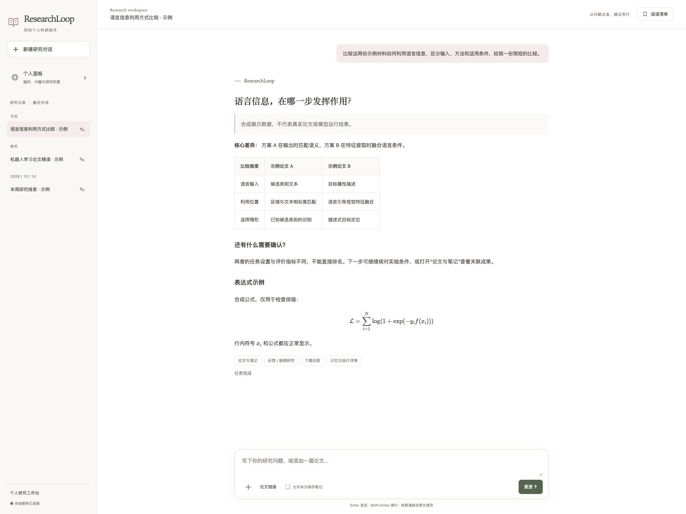
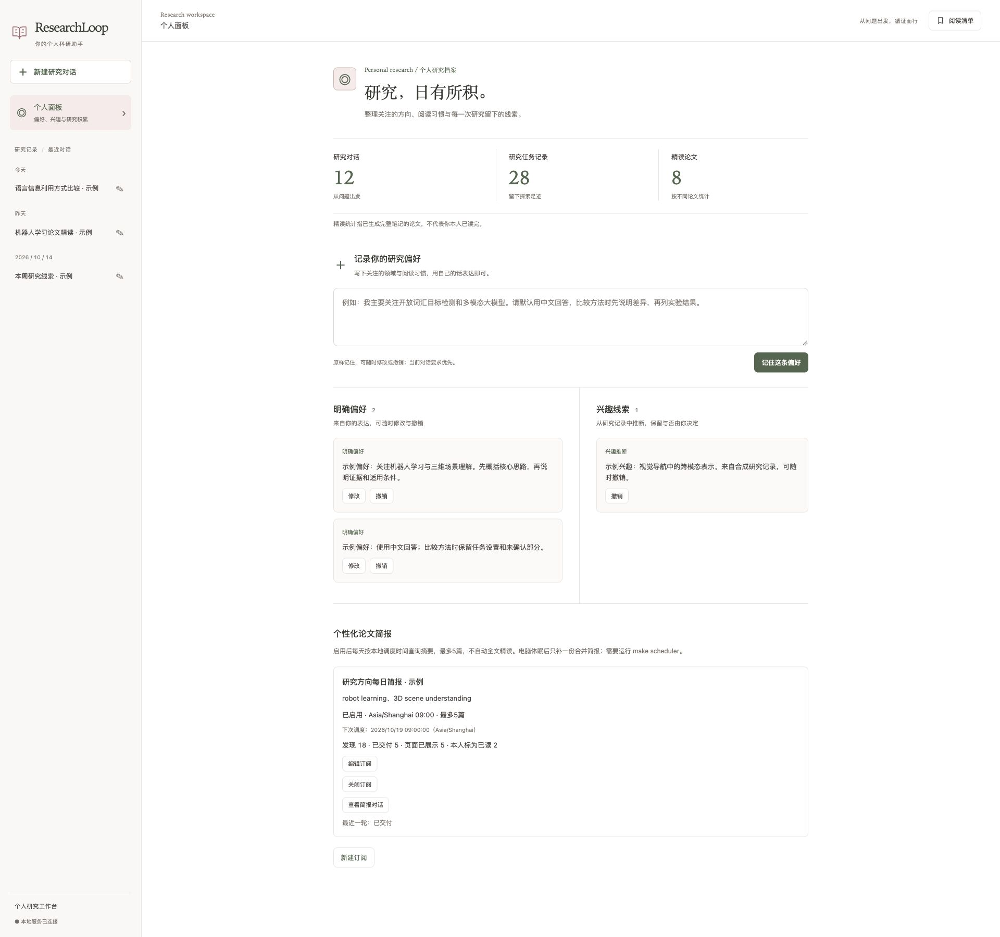
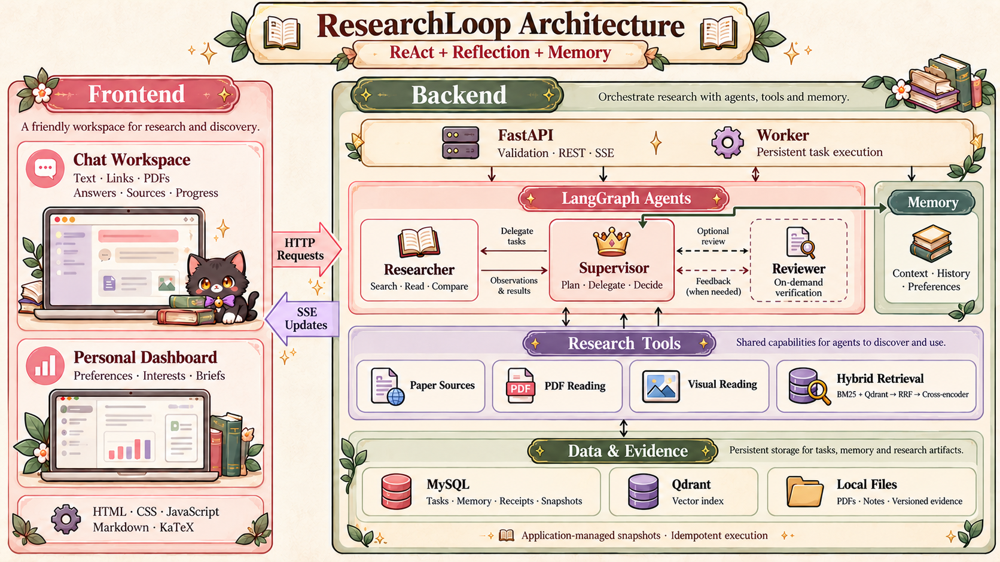

  

<h1 align="center">ResearchLoop</h1>

<strong>Research Intelligence &amp; Evidence Reading</strong>

  
  
  
  
  
  

  <a href="#preview">Interface Preview</a> ·
  <a href="#features">Core Features</a> ·
  <a href="#architecture">Workflow Architecture</a> ·
  <a href="#quick-start">Quick Start</a>

**ResearchLoop** 让你通过对话查找和研读论文、比较研究方法、整理研究笔记，并结合个人兴趣持续跟踪值得关注的研究进展。

## Interface Preview

  

  

## Core Features

| Feature | Description |
|---|---|
| **论文发现** | 根据研究主题、时间和数量寻找论文；需求不明确时先澄清，不可用的来源会如实说明 |
| **原文问答** | 添加论文链接或上传 PDF，围绕核心方法、实验和公式提问，查看可定位的原文依据 |
| **跨论文比较** | 汇合多篇论文的研究发现，区分方法差异、实验条件、适用范围和资料缺口 |
| **精读与笔记** | 明确要求精读时生成八点笔记，回答、笔记、证据和阅读清单作为聊天成果，按本次授权保存 |
| **按需核验与修订** | 根据具体问题补读原文、核验结论或局部修订；无法确认的部分保留说明并合理结束 |
| **连续研究记忆** | 结合多轮对话、相关研究历史、长期偏好与兴趣线索继续研究，支持上下文压缩后接续 |
| **个性化论文简报** | 按研究方向及已读、曝光记录去重，默认每天 09:00（上海时区）交付最多 5 篇候选，不自动全文精读 |
| **任务进度与历史** | 展示真实进度和回答增量，支持澄清、取消及断线接续；历史对话按日期分组，并可修改名称 |

### Example Requests

> 找两篇近三年的开放词汇目标检测论文，比较它们如何利用语言信息。基于实际读取的原文生成一份简短比较笔记，注明出处和未解决的问题，并保存到项目中。

> 根据我上传的 PDF，解释它的核心方法和实验条件。没有原文支持的细节请直接说明，不要保存文件。

> 以后优先关注开放词汇目标检测和多模态大模型，回答使用中文，比较方法时保留实验条件。

这些是输入示例，任务结果取决于实际取得的材料、已配置的服务和模型输出；未完成的部分会与已有成果一同说明。

## Workflow Architecture

前端提供研究对话与个人面板，通过 HTTP 请求和 SSE 事件与后端连接；后端负责研究任务执行、工具调用、记忆管理和成果持久化。

采用 **ReAct＋Reflection＋Memory** 架构，基于 LangGraph 编排 Supervisor、Researcher 和 Reviewer，通过共享研究状态和独立角色上下文协作；Supervisor 根据目标与观察动态选择路线，不要求每次任务经过全部角色。

  

### Agent Roles

| Role | Responsibility |
|---|---|
| **Supervisor** | 理解目标、澄清需求、规划与委派，根据任务覆盖与工具观察调整路线，汇合成果并决定继续或结束 |
| **Researcher** | 使用授权工具检索和读取论文，整理与研究目标相关的发现、原文依据和材料缺口 |
| **Reviewer** | 按需独立核验当前结果，区分支持、反证和缺证，回传具体问题与处理依据 |

### Design Principles

- **ReAct**：通过“决策—行动—观察”推进研究，由代码校验工具参数、来源版本、权限和执行边界。
- **Reflection**：按需选择核验、补读或局部修订；结合证据与修订进展决定后续动作，区分工具执行失败和原文缺证，避免无差别重写。
- **Memory**：分离会话上下文、研究历史与长期画像；压缩时保留目标、约束和成果身份，归档材料通过受控工具按需读回。当前要求优先于历史偏好，记忆不继承保存权限。
- **Hybrid RAG**：原文保留版本、物理页码及内容 hash，采用 BM25＋Qdrant 双路召回、RRF 融合和 Cross-encoder 重排，范围限制在任务授权材料内。
- **Persistent Execution**：API 与 Worker 分离，通过 SSE 展示进度与回答；MySQL 保存任务、事件、模型收据和项目自实现快照，结合原子领取、租约校验与幂等保存处理并发和中断。成功收据复用，未知请求不盲目重发。

**Tech Stack:** Python / FastAPI / LangGraph / MySQL / Qdrant / ONNX Runtime / JavaScript / Markdown / KaTeX / SSE。

## Quick Start
