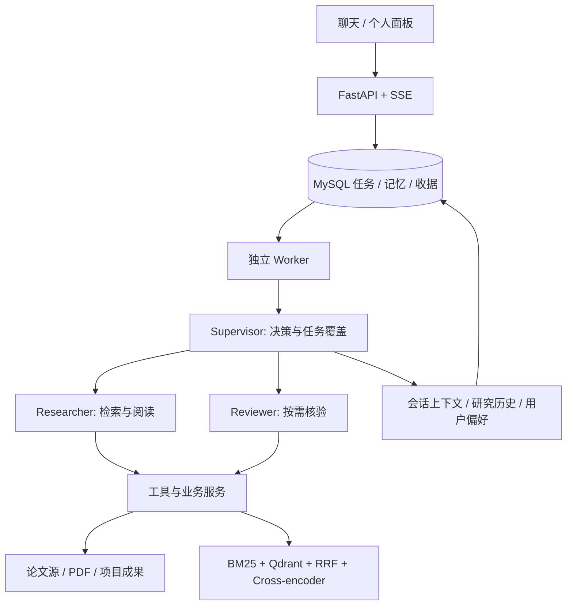

# ResearchLoop

面向文献跟踪与课题调研的对话式科研 Agent。本机单用户应用，以自然语言完成论文检索、全文问答、精读与跨论文比较，并根据用户研究画像生成增量论文简报。

## 架构与能力

采用 **ReAct＋Reflection＋Memory** 架构，使用 **LangGraph** 编排 Supervisor、Researcher、Reviewer；后端使用 Python / FastAPI / MySQL，前端通过 SSE 展示任务进度与回答增量。



- **动态协作：** 需求澄清、任务拆分、并行取证与观察后改路；角色拥有各自上下文及工具权限，不表示独立训练的模型。
- **按需 Reflection：** 补读原文、核验当前回答、局部修订；区分反证、缺证和执行错误，允许保留已有成果合理结束。精读请求使用独立八点总结节点，普通问答不隐含精读或强制全稿审核。
- **分层 Memory：** 会话上下文、历史研究和用户画像分开维护；支持可撤销兴趣推断、自然语言偏好、上下文压缩及授权范围内的档案读回。
- **版本化检索：** 保留文档版本、页码与内容 hash，混合召回及重排为原文问答提供可定位证据。文字为默认读取路线，公式或图中关系缺证时可按需视觉补读。
- **持久执行：** 原子领取、租约、取消、项目自实现快照、成功模型收据复用、未知请求阻断和幂等保存；任务执行独立于浏览器连接。

## 本机安装

需要 Python 3.14、uv、Node.js/npm 和 Docker。已验证环境为 macOS ARM64；其他平台及本机重排权重需自行验证。

```bash
git clone https://github.com/CsBillChang/ReasearchLoop.git
cd ReasearchLoop
cp .env.example .env
make sync-index
(cd frontend && npm ci)
make infra
make migrate
```

在 `.env` 中填写自己的 `DEEPSEEK_API_KEY`，并确认 `DEEPSEEK_MODEL` 对账户可用。`.env.example` 上半部分为最小配置，下半部分均为可选覆盖项；进程环境变量优先于 `.env`。不要把真实配置上传。

### 论文源配置

```bash
mkdir -p data/config
cp config/paper-sources.example.json data/config/paper-sources.json
```

在本机 JSON 中为需要的来源填写合法的只读 Supabase 地址、公开读取凭据及 RPC，并将该来源的 `enabled` 改为 `true`。共享连接也可由 `.env` 中的 `SUPABASE_URL`、`SUPABASE_ANON_KEY` 等覆盖。不同论文源使用独立 RPC；未配置的来源明确返回 `not_configured`。仓库不分发第三方服务的访问凭据，也不保证所有来源始终可用。

已有同格式 YAML 配置可通过下面的导入器复制，只接受公开/匿名读取凭据，输出文件禁止覆盖：

```bash
PYTHONPATH=backend .venv/bin/python backend/scripts/import_paper_sources.py /path/to/source-config.yaml
```

### 本机向量与重排模型

权重不随源码分发。`config/model-manifest.example.json` 记录模型仓库、版本、文件及校验信息；另行下载相应文件并设置清单中的本机目录，再设置：

```dotenv
RESEARCHLOOP_RETRIEVAL_MODEL_MANIFEST=data/local-models/manifest.json
```

可单独运行 `backend/scripts/preflight_retrieval_models.py --help` 查看组件预检入口。未准备权重时可设置 `RESEARCHLOOP_RETRIEVAL_ENABLED=0`；这不等同已启用混合检索。图片裁剪依赖为可选，参数见配置模板。

## 启动与维护

```bash
make start     # API 18082 / 前端 4173 / Worker / Scheduler
make status
make diagnose  # 零生成模型诊断
make stop      # 等待在途请求结算
```

打开 http://127.0.0.1:4173/ 。聊天支持文字、论文链接、PDF 上传及同会话追问；任务可以澄清、取消，或按授权保存成果。个人面板维护偏好与简报订阅；每日09:00上海时区最多5篇候选，不自动全文精读，停机后合并补报。

冷备份前先停止应用；恢复必须指定新的隔离数据库和目录，默认不恢复任务执行权限：

```bash
make backup ARGS="--help"
make restore ARGS="--help"
make test
make check
```

默认测试不调用生成模型；环境门控跳过不计作真实验收通过。历史验收及报表脚本依赖未公开材料，不能作为首次启动或自动评测入口。

## 代码与公开边界

| 路径 | 职责 |
|---|---|
| `backend/research_loop/api/` | HTTP 验证、依赖注入与 SSE |
| `backend/research_loop/agents/` | 角色决策、上下文与 Reflection |
| `backend/research_loop/tools/`、`domain/` | 工具注册、参数、权限及数据合同 |
| `backend/research_loop/services/` | 任务、论文、成果、记忆、检索与简报业务 |
| `backend/research_loop/providers/`、`storage/` | 模型/论文/本机推理适配与持久化 |
| `backend/research_loop/workers/` | 排队执行、租约、恢复与调度 |
| `backend/migrations/`、`tests/`、`scripts/` | 数据迁移、分层验证及维护命令 |
| `frontend/`、`config/` | 聊天/个人面板与无凭据配置模板 |

公开仓库保留源码、依赖锁、迁移、测试与配置模板；`docs/`、`artifacts/`、`data/` 是本机材料，不上传，也不随克隆附带。私人对话、PDF、权重、数据库和原始模型响应均不分发。第三方适配代码的归属和许可集中在 [NOTICE](NOTICE)，业务模块采用中性名称。

本项目不包含公网多租户部署、Obsidian 同步或引用量排序。结构化矩阵仍为实验能力；固定小样本评测不能外推到所有论文。模型可能误判或缺证，任务可为 `partial`；交付应说明保留成果、执行原因及待确认事项，不保证所有任务成功。
