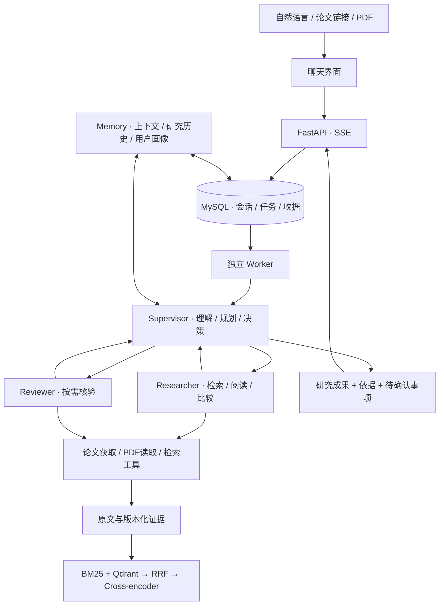

<p align="center">
  
</p>

<h2 align="center">让一个研究问题，连接论文、证据与研究记忆。</h2>

<p align="center">
  
  
  
  
  
</p>

<p align="center">
  <a href="#features">核心功能</a> ·
  <a href="#scenarios">使用场景</a> ·
  <a href="#architecture">工作流架构</a> ·
  <a href="#quick-start">快速开始</a> ·
  <a href="#faq">常见问题</a>
</p>

**ResearchLoop** 是一个以自然语言对话为入口的个人科研 Agent 应用。你提出研究目标，Agent 选择工具、分派研究任务、阅读原文，并将发现、证据和待确认问题组织成可继续追问的成果。

从找论文、问论文，到精读和跨论文比较，都在同一个对话中完成。个人面板维护研究兴趣、长期偏好和论文简报订阅，让后续研究能够接着已有记录继续。

<a id="features"></a>

## ✨ 核心功能

| 功能 | 可以做什么 |
|---|---|
| 🔎 **自然语言找论文** | 说明主题、时间和数量，按配置的论文来源检索；需求不清楚时先澄清 |
| 📖 **原文研读与问答** | 添加论文链接或上传 PDF，围绕方法、实验、公式提出问题，查看原文依据 |
| 🧩 **跨论文比较** | 委派 Researcher 分别取证，再围绕问题汇合差异、适用条件和资料缺口 |
| 📝 **精读与成果保存** | 按需生成八点精读笔记、比较稿和阅读清单，经本次授权保存到项目中 |
| 🔍 **工具辅助核验** | Supervisor 按需调用 Reviewer，选择补读、局部修订或带着明确局限交付 |
| 🧠 **连续研究记忆** | 多轮上下文、压缩接续、相关历史召回、自然语言偏好与可撤销的兴趣推断 |
| 📰 **增量论文简报** | 根据研究方向及已读、曝光记录去重，每天生成最多 5 篇候选简报 |
| 💬 **可见的执行过程** | 流式显示任务进度和回答，支持澄清、取消、断线接续与中断恢复 |

<a id="scenarios"></a>

## 🧭 从这些问题开始

### 找到值得读的论文

> 找三篇近三年关于开放词汇目标检测的论文，说明各自研究的问题，并附上论文链接。

### 围绕原文深入追问

> 根据我上传的 PDF，解释它的核心方法。哪些结论有实验支持，哪些还需要进一步确认？不要保存文件。

### 把分散材料整理成研究成果

> 比较这两篇论文如何利用语言信息，区分它们的任务设置和实验条件，生成一份简短比较笔记并保存到项目中。

### 让下一次研究接着这一次继续

> 以后优先关注开放词汇目标检测和多模态大模型，回答使用中文，比较时尽量保留实验条件。

这些是任务输入示例，不是预置答案。任务结果取决于可取得的原文、已配置的工具和模型输出；无法完成的部分会与已有成果一起说明。

<a id="architecture"></a>

## ⚙️ 工作流架构

**ReAct＋Reflection＋Memory**：Supervisor 根据目标与工具观察动态决定下一步，Researcher 负责检索和研读，Reviewer 按需核验当前结果。三个角色由 LangGraph 编排，通过共享研究状态和各自上下文协作。



- **ReAct：** 思考、行动、观察，再根据实际进展调整工具调用与任务委派。
- **Reflection：** 从当前稿件和原文出发，区分支持、反证、缺证与工具执行失败，针对具体问题处理。
- **Memory：** 将会话、研究历史和长期画像分层管理；压缩后保留目标与成果身份，原证据可以按权限读回。
- **持久执行：** MySQL 保存任务状态、事件和模型收据，结合租约与项目自实现快照恢复；成功请求不因重启重复发送，未知请求不会盲目重发。

<a id="quick-start"></a>

## 🚀 快速开始

> [!TIP]
> 先准备自己的模型 API Key。应用运行在本机，不需要 GitHub PAT，也不依赖 GitHub Actions 或 GitHub Pages。

### 1. 准备环境与配置

需要 **Python 3.14、uv、Node.js/npm、Docker**。当前验证环境为 macOS ARM64。

```bash
git clone https://github.com/CsBillChang/ReasearchLoop.git
cd ReasearchLoop
cp .env.example .env
```

在 `.env` 中填写 `DEEPSEEK_API_KEY`，并确认 `DEEPSEEK_MODEL` 对你的账户可用。模板只启用最小配置，其他选项保留为注释；真实 `.env` 不应提交到仓库。

### 2. 安装依赖并初始化数据库

```bash
make sync-index
(cd frontend && npm ci)
make infra
make migrate
```

Python 版本和依赖由 uv 管理，依赖锁文件位于 `backend/uv.lock`。

### 3. 启动并开始对话

```bash
make start
```

打开 **http://127.0.0.1:4173/** 。可以先上传一份 PDF，询问研究问题和核心方法；启用论文发现与混合检索前，再完成下面的可选配置。

| 本机服务 | 地址 / 职责 |
|---|---|
| 前端 | `http://127.0.0.1:4173/` |
| API | `http://127.0.0.1:18082/` |
| Worker | 独立执行研究任务，浏览器关闭后任务仍可继续 |
| Scheduler | 按个人面板中的订阅生成增量简报 |

<details>
<summary><strong>🔎 配置论文来源</strong></summary>

```bash
mkdir -p data/config
cp config/paper-sources.example.json data/config/paper-sources.json
```

为需要的来源填写合法的只读 Supabase 连接与 RPC，并将对应来源的 `enabled` 改为 `true`。共享连接可以通过 `.env` 中的 `SUPABASE_URL`、`SUPABASE_ANON_KEY` 等覆盖；自定义配置位置使用 `RESEARCHLOOP_PAPER_SOURCES_CONFIG`。

来源目录包含 arXiv、CVPR、ECCV、ICLR、NeurIPS、ICML、AAAI、IJCAI、ACL、EMNLP 等 17 个入口。不同来源使用独立 RPC；未配置的来源返回 `not_configured`，不会假装已经完成检索。访问凭据和远端论文库不随源码分发。

已有同格式 YAML 配置可导入为本机 JSON；导入器只接受公开/匿名读取凭据，且不会覆盖已有文件：

```bash
PYTHONPATH=backend .venv/bin/python backend/scripts/import_paper_sources.py /path/to/source-config.yaml
```

</details>

<details>
<summary><strong>🗂️ 配置本机向量检索与重排</strong></summary>

`config/model-manifest.example.json` 提供模型仓库、版本、文件和校验信息。另行准备权重，填写清单中的本机目录，然后设置：

```dotenv
RESEARCHLOOP_RETRIEVAL_MODEL_MANIFEST=data/local-models/manifest.json
```

检索路线为 **BM25＋向量召回 → RRF 融合 → Cross-encoder 重排**，范围限制在任务已授权材料内，保留文档版本、页码和内容 hash。

组件预检入口：

```bash
PYTHONPATH=backend .venv/bin/python backend/scripts/preflight_retrieval_models.py --help
```

权重不随仓库分发。尚未准备时可以设置 `RESEARCHLOOP_RETRIEVAL_ENABLED=0`；关闭后不具备完整混合检索能力。模型文件及运行环境需按当前平台验证。

</details>

<details>
<summary><strong>🖼️ 可选图表与视觉补读</strong></summary>

文字是默认读取路线。Supervisor 可在公式损坏或图中关系缺证时按需委派视觉补读，需账户支持图像输入。图表裁剪可配置 PaperCropper，未配置或失败时回退到 PyMuPDF 内嵌图片提取；相关选项见 `.env.example`。

图片提取不等于图像理解。任务会保留实际读取范围和工具返回的局限。

</details>

## 🛠️ 日常使用与开发

```bash
make status    # 查看受管服务
make diagnose  # 检查配置与本机依赖，不调用生成模型
make stop      # 等待在途请求结算后停止
make test      # 默认离线测试
make check     # Python / JavaScript 语法检查
```

备份前先停止应用。恢复使用新的隔离数据库与目录，默认不自动恢复任务执行权限：

```bash
make backup ARGS="--help"
make restore ARGS="--help"
```

<details>
<summary><strong>📁 项目结构</strong></summary>

```text
ResearchLoop/
├── backend/
│   ├── research_loop/
│   │   ├── api/          # HTTP、依赖注入与 SSE
│   │   ├── agents/       # Supervisor / Researcher / Reviewer
│   │   ├── tools/        # 工具注册与执行入口
│   │   ├── domain/       # 参数、身份、权限与数据合同
│   │   ├── services/     # 任务、论文、成果、记忆、检索与简报
│   │   ├── providers/    # 模型、论文源、PDF与本机推理适配
│   │   ├── storage/      # MySQL、文件、索引与快照
│   │   └── workers/      # 排队执行、租约、恢复与定时调度
│   ├── migrations/       # 数据库迁移
│   ├── tests/            # 单元、集成及显式验收
│   ├── scripts/          # 启动、诊断、备份与评测工具
│   ├── pyproject.toml
│   └── uv.lock
├── frontend/             # 聊天、个人面板与成果展示
├── config/               # 无凭据配置模板
├── .env.example
├── compose.yaml
└── Makefile
```

</details>

<a id="faq"></a>

## ❓ 常见问题

### 能直接使用 GitHub Pages 部署吗？

当前版本是本机单用户应用，需要 Python 后端、MySQL 和 Worker，不是纯静态站点。已验证 macOS ARM64；其他平台需另行验证。

### 为什么有些任务显示“部分完成”？

论文无法取得、证据不足或工具执行失败时，Agent 可以保留已有成果并说明待确认事项。`partial` 不代表没有输出，也不等于核验通过；模型与核验本身仍可能出错。

### 精读和普通论文问答有什么区别？

只有明确要求精读笔记时才调用八点总结节点。普通问答、方法比较和综述围绕当前研究问题取证，不会默认整篇精读或强制全稿审核。

### 个性化简报会自动精读全文吗？

不会。默认每天 **09:00，Asia/Shanghai**，最多 5 篇候选，提供摘要、推荐理由与来源；停机后合并补报遗漏时段。全文研读由后续任务按需发起。

### 我的对话、论文和配置会上传到 GitHub 吗？

不会随代码发布。真实 `.env`、论文 PDF、模型权重、数据库、对话和原始轨迹保留在本机；`docs/`、`artifacts/`、`data/` 不随公开仓库分发。使用外部模型和论文服务时，相关请求仍会发送到你配置的服务。

### 克隆后能复现所有历史评测吗？

默认测试使用合成输入和替身；外部依赖与真实调用测试有显式门控。历史评测脚本需要另备材料，固定小样本结果不代表所有任务的效果，也不会在启动时自动重跑。

---

依赖和模型遵循各自许可证；第三方改编部分的版权及完整许可声明随相关源码保留。
