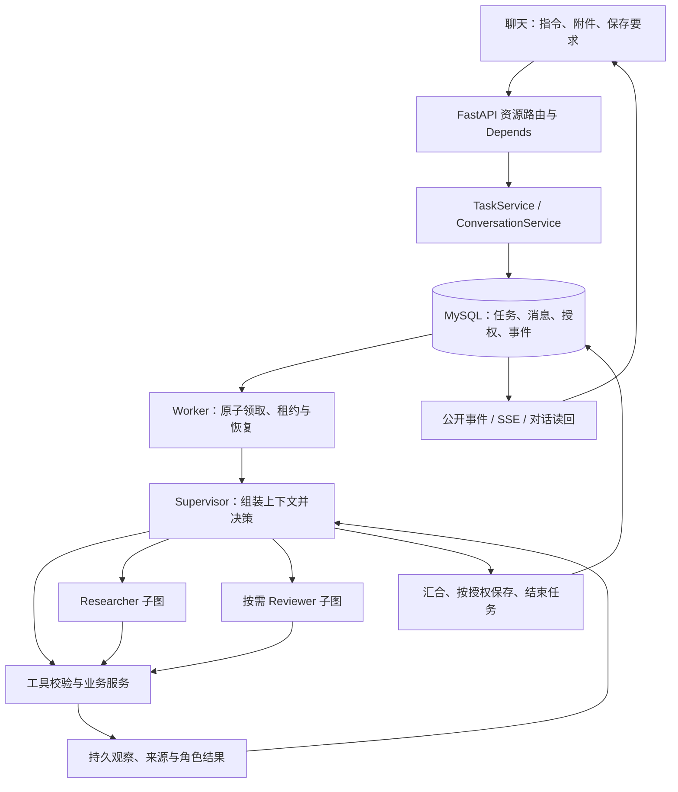

# ResearchLoop 架构与调用链

本页描述当前实现与确定的目标，文件导航见 [file-map.md](file-map.md)，待补齐范围只在 [improvement-plan.md](improvement-plan.md) 维护，执行结果只在 [status.md](status.md) 维护。目标是用户认可的 ResearchLoop 项目描述，不是开发前的旧 LaTeX 简历，也不照搬参考简历的 Agent 数量。

## 产品和技术边界

本机单用户科研应用，只有聊天和个人面板两个主入口。用户通过自然语言、论文链接或 PDF 完成检索、原文问答、精读和跨论文比较；附件、证据、笔记、阅读清单都作为对话产物。个人面板展示偏好、可撤销兴趣推断和研究记录，并管理增量简报。

后端使用 Python，版本与依赖由 uv、`.python-version`、`pyproject.toml` 和 `uv.lock` 管理。FastAPI 负责 HTTP，独立 Worker 执行长任务，MySQL 保存业务状态，Qdrant 保存派生向量索引。架构为 **ReAct＋Reflection＋Memory**，由 LangGraph 编排 Supervisor、Researcher、Reviewer。

| 目标能力 | 当前实现 | 尚不能作出的承诺 |
|---|---|---|
| 自然语言自主研究 | Supervisor 选择工具、澄清、分解目标、动态委派和汇合；工具观察进入后续决策 | 阶段进展、互补原文工作集与无进展交接已接入；工程验证与真实语义结果分别见 status.md |
| 多 Agent 协作 | 三个角色分别实例化图，独立上下文和工具权限；Researcher 当前最多两线程并行 | 不是三个独立训练模型，也不是固定六 Agent 流水线 |
| 按需 Reflection | 草稿及候选/阶段发现/回答快照的独立核验；适用性与事实判断分开；补读、局部版本、明确结束 | 通用入口的工程与隔离结果见status；未因此宣称真实模型总能正确核验或收敛 |
| 分层 Memory | 会话历史、研究记录、偏好/推断、归档及上下文投影 | 有固定材料接续证据，但不是无损记忆，也未解决任意长任务的证据接续 |
| 混合 RAG | 版本化页/片段，BM25＋向量＋RRF＋Cross-encoder，授权范围过滤与定位读回 | 相关性排序不等于事实核验；旧小样本结果不能外推为总体收益 |
| 持久执行和交互 | 原子领取、租约、模型响应收据、自实现快照、SSE 重放、幂等保存 | Checkpoint 不是 LangGraph 原生 Checkpointer；未知远端请求不保证 exactly-once |
| 图表增强 | 可选裁图/PyMuPDF提取；Supervisor按需委派已读页的单次视觉节点 | 文字默认；明确公式或空间关系缺口才选择；视觉观察不覆盖原文，组件对照和日常调度验证分开 |

## 角色、机制和工具的关系

**Supervisor** 持有用户目标、最新澄清、材料权限和交付要求。它决定直接使用工具、委派 Researcher、请求 Reviewer、追问用户或结束任务。简单检索不必读取所有全文；普通问答与比较不隐含八点精读；缺证不能伪装任务完成。

**Researcher** 在子目标和授权材料范围内检索、读取与整理发现，返回来源、发现和缺口；不创建正式笔记、不保存文件、不批准自己的结果。现在可通过 `record_research_progress` 提交阶段发现，`finish_research` 复用同一合同结束；未独立核验的发现保持候选状态。成功行动先落库，快照落后时重放，Worker 在提前结束或异常时读回已提交成果。没有提交过的内部推理不当作成果。

**Reviewer** 核对被选定的候选、阶段发现、回答或当前稿，允许补读取证，输出判断和建议动作。**Reflection 是包含 Reviewer 的控制机制**：Supervisor选择待查内容及补证/修改/结束动作；服务验证对象版本、证据和权限，持久化判断、修订差异与进展。简单检索和普通回答可以直接交付。

三个角色的提示词与交接工具使用同一职责边界：已有回答的原文、身份、核验问题与已有来源足够发起核验，Supervisor无需先自行审完全部事实。Researcher及时交回发现、依据、条件和缺口，自评不作为独立批准。重复读回后的交接仍保留角色实际允许的核验/局部修订/明确结束工具；新核验或修订身份允许后续按观察行动，同ID重放不算新进展。执行交接进展与事实修复进展分开，核验得到反证不等于内容已经修好。

材料取得、当前模型可见与研究成果变化分别记录。取证覆盖按同文档/版本/物理页的精确字符区间及原字词比较；整页已包含的片段不算新增。可见性只从产生当前工具批次的实际请求receipt重建，缺少请求时标未知，不根据read_paper名称推断读回。整批有互补新材料时允许继续；反复返回既有且已展示/恢复的材料时进入已有成果交接，不以新增次数限制代替进展。

明确绑定的当前回答在Memory投影中完整保留一份，重复history/读回/同版本target引用同一请求内路径；局部新版本优先且不替代旧消息身份。原件、证据权限及DeepSeek推理/工具配对保持。执行约束（未保存、无关段落保持）依据程序记录或注明未检查，不要求论文原文证明；Reviewer收到的execution_checks明确限定父任务保存记录、禁止保存及未提供段落差异检查。错误结果保留first_error/tool_errors，同时用blocking_error/last_error突出最后未接收的提交，未完成核验不变成反证或批准。真实模型是否按这些观察高效行动仍须分层验证。

通用路径是`review_research → 定向补证/委派或revise_research → 按需复核/close_research_issue → finish_task`；各步骤由Supervisor按观察选择。候选从实际成功搜索行动加载，发现从成功进展行动加载，回答直接形成内部快照，不要求创建笔记。修订不覆盖原子任务/行动；对原版的判断不继承到新文字。旧`review_note/revise_note`继续兼容。

元数据适用性为suitable/unsuitable/uncertain，科学主张为supported/contradicted/insufficient。准确披露执行范围可用scope_disclosure并绑定已读证据，不强求论文原句证明“本次未读某页”；该类别不能批准科学断言。引句检查只证明真实存在，判断是否支持仍由独立角色承担。执行失败/unknown与语义判断分开。

每个对象保留内容hash、来源版本、稳定项目ID、中性核验问题、尝试、patch和结束选择。补证及Reviewer自行读取的实际材料按版本/位置/正文去重；同输入复用。进展跟踪同一项目的判断变化，不以意见数变少、换ID或润色算解决。独立问题分开保存，不能用另一问题的通过覆盖旧疑点。现有轮次和根任务预算保持，停止不自动变成批准。

同一对象允许多条核验意见，item_id不作为意见的唯一键。全部原始判断保留，展示身份由核验记录与条目序号派生；进展汇总检查同对象的所有状态，不能用最后一条支持意见遮住反证或缺证。汇总仅表示Reviewer在该对象/问题范围内给出的状态变化，不是语义正确率或完整问题解决的证明。

执行失败通过execution_error传递已落库的工具错误、首个具体错误及最终停止原因，不转换成论文缺证。finish_task绑定回答快照时省略answer_markdown，服务读回原正文；processing_summary单独记录处理说明。结果中的answer_body_markdown保持正文，review_notices保存核验说明，answer_markdown为兼容聊天展示的组合文本。是否成功交付与是否所有判断supported分开：准确披露未解决问题或执行故障并保留成果，可以partial结束，不以答案完全正确为完成条件。

**Memory** 负责跨消息、跨任务的可追溯接续，不替模型决定本次事实。当前指令优先于长期偏好，明确偏好优先于推断；旧稿/摘要不是原文，历史保存许可不能继承。

工具是受控能力接口，统一由 `ToolSpec` 生成 schema 并定位执行函数，参数、角色、身份和副作用由代码验证。Agent 调用检索、读取、笔记、记忆等业务工具；没有开放任意 SQL 或任意 Qdrant 写入给模型。DPR 精读包含模型调用，是显式精读时选择的固定节点，不等于又增加一个独立 Writer Agent。

## 从用户输入到交付

1. **接收请求。** `frontend/src/app.js` 提交会话、prompt、附件身份、保存策略和幂等键。`main.py → api/router.py → api/tasks.py` 接收；`api/dependencies.py` 用 FastAPI `Depends` 装配配置、数据库和服务。路由验证输入、映射状态码，不执行长研究。
2. **建立任务。** `services/tasks.py` 与 `services/conversations.py` 持久化任务、消息、授权材料与事件，处理幂等和同会话在途任务。澄清用原任务 resume；取消后按新要求继续走 continuation。自然语言计划不能扩大保存权限或附件权限。
3. **领取和恢复。** `workers/executor.py` 原子领取、续租，检查取消及未知请求，恢复 `storage/checkpoints.py` 快照，组装角色图及服务。成功模型响应及用量先落库再解析，恢复时复用；不能因快照滞后盲目重发。
4. **思考—行动—观察。** `agents/graph.py` 的 `decide` 组装可用工具与上下文，模型决定下一步；`execute_tools` 经 `tools/registry.py` 校验并调用服务。`domain/tasks.py` 的 Observation 与持久 action 记录结果，再进入下一次决策。公开进度不暴露内部推理文本。
5. **动态委派。** Supervisor 通过 `tools/delegation.py` 提交目标和子任务；Worker 的 `_run_research_batch` 执行 Researcher，`_review_once`/`_review_research_once`执行草稿/通用Reviewer。`services/coverage.py`管理目标覆盖、材料范围及交付合同；显式选择的核验结果和未解决项随交付呈现，不证明任意内容语义正确。
6. **汇合交付。** Supervisor 整理研究结果，必要时创建稿件、按权限保存并调用 `finish_task`；Worker 的 `_deliverable_result` 处理最终结果/部分成果，TaskService 落终态，ConversationService 整理对话记录。服务异常时也应保留已形成成果并说明停止原因；本轮已补异常保留并完成隔离验证，真实长任务效果仍待复验，不能把工程通过当作语义保证。
7. **前端读回。** `api/events.py` 输出 JSON 事件和 SSE，支持事件序号及 `Last-Event-ID` 接续；`api/artifacts.py` 读回授权证据、稿件及保存结果。页面断开与后端任务生命周期分离。

## 一个两篇比较任务

用户：“比较这两篇论文如何利用语言信息，约 600 字，不保存。”

期望：Supervisor 识别材料和比较维度 → 按需委派两名 Researcher → 原文读取/定向检索 → 分别整理与问题直接相关的发现 → Supervisor 汇合共同点、差异和未知项 → 聊天交付。只有存在值得独立核验的问题时选择 Reviewer；不自动做八点精读、不写 Markdown。

修复前最近真实轨迹显示：原文读取成功后，工具历史与重复元数据持续增长；正文被压短，角色再次补读；部分子任务未到 `finish_research` 就因应用容量检查结束，父任务拿不到结构化发现。**能读取、能委派，不等于能持续保留研究成果并完成汇合。** 当前工程增加互补窗口与基于实际观察的进展交接；验证结果统一见 status.md，不把旧短材料通过或零模型重放当作真实长比较成功。

## 原文、RAG 和数据归属

获取沿用 DPR 的逐源 Supabase RPC 适配；这是候选元数据入口，不保证每篇 PDF 可访问。正文使用缓存→Jina→PDF/PyMuPDF，限定物理页或本地 PDF 走直接 PDF 路线。Jina 无可靠页码时明确为空；PyMuPDF4LLM 不是当前默认，Docling 仅参考。可选 PaperCropper/DocLayout-YOLO 裁图与 PyMuPDF 回退沿用现有接口；全文已提取不代表图像/复杂公式已理解。

视觉补读由Supervisor通过`delegate_visual_reading`按需委派，Researcher遇到具体公式损坏或图中关系缺口时先交回页身份与问题。Worker从实际evidence_id派生版本/物理页/hash，只给专用Researcher子任务本页权限和既有PDF缓存，执行一个LangGraph视觉节点；原共享额度、收据、取消与恢复保持。图片准备是本地工具，模型理解在节点中运行，不新增自主角色或全页扫描。

父角色接收带来源的未核验模型观察；图片base64、完整页文字和父历史不交叉复制。原回答留在子任务，观察按6000字符分页，同一委派的offset读回复用原结果，不重新生成。无物理页、无本地PDF/缓存、配置不可用时明确交回缺口；供应商错误/未知用量沿原策略阻止新增请求并保留成果，不补零或自动换供应商。代码接线、替身选择、组件真实效果和部署后的自然语言调度是不同证据层。

RAG 链路：`授权文档版本 → 页内段落/token 片段 → BM25 与本机 E5 向量召回 → RRF → Cross-encoder → 原文位置读回`。当前默认重排 24 条；任务目标适合短文直接阅读时不强制 RAG。查询/索引故障要报告降级，不把空命中当作论文没有相关内容。

| 存储 | 保存的数据 | 不应混淆的边界 |
|---|---|---|
| MySQL | 任务/子任务、事件/action、模型收据、稿件、版本/页/片段正文、授权、会话、偏好、历史研究、简报状态 | 业务事实来源；研究发现是模型产物，不能冒充原文 |
| Qdrant | embedding 与片段/文档/版本/位置/hash/索引身份等 payload | 可重建的检索索引，正文权威记录仍在 MySQL；不是对话、预算和权限的主库 |
| 项目文件 | PDF/解析缓存/图片、明确允许保存的 Markdown、备份与原始验收证据 | 内部运行状态持久化与用户授权导出笔记是不同操作；deny 不禁止安全保存内部任务状态 |

## 上下文与持久化边界

原始 messages、来源、action、receipt 和档案应保留；传给模型的是当前角色可用的投影，不是无限追加全部历史。当前抽取式压缩不额外调用模型；旧工具整组归档后，按文档版本保留多个去重连续窗口，优先保护最近两个不同定向读页批次的互补内容，再按容量放入其他历史。保留当前目标、阶段发现、缺口及必要原文；工具schema和外层上下文也计入容量。相同本地 PDF 的精确读取在当前权限/页范围/文件与来源版本不变时可复用，检索观察区分新增材料、重复结果与上下文读回，不裁定语义正确。字节数与供应商实际 token 分开报告；仍采用保守字节上界估计 token，不宣称准确 tokenizer 或 Token 节省率。旧原始请求不改写。

相同材料再次读回而没有阶段变化时，图转入现有交接工具：模型交付已有发现，或先记录发现/具体缺口再继续研究；没有有效交接或越过可见工具时，保留成果并partial结束。触发依据来自成功行动及材料身份，不是新增累计请求/Token额度，也不是事实真假判定。新来源或有效阶段更新可重新开放补读；已知请求仍按原收据恢复，不改旧参数。

Supervisor交接模式保留原已授权read_memory，使档案外置入口与实际可执行工具一致。当前任务档案、同会话此前assistant回答可以分页读回；同一交接边界按来源版本和已读区间记录导航，首次覆盖新范围后允许继续Reviewer或交付。导航不刷新研究进展；重复区间或反复更换同类档案身份不会无限延长交接。Researcher不因此新增记忆工具，原文权限和现有预算保持。

异常交付优先保留当前稿/局部版本/阶段成果；这些均未形成时，ConversationService.referenced_answer只从当前指令明确内容hash或成功message读回的唯一身份解析同会话已有回答。来源必须在当前用户输入之前，角色为assistant且版本匹配；无明确身份、多个不同候选或过期/外来消息不自动回退最近回复。Worker把原文、来源身份和未完成原因分开交付，保持unreviewed与本次保存权限，不把历史回答当论文依据。

整份请求工作集由 `domain/context_workspace.py` 统一核对当前成果、历史和大型工具观察。来源目录用本次成果内的短别名减少重复，真实身份/hash仍完整保留；先外置持久诊断和旧研究详情，容量不足时才摘录超长候选正文。摘录明确标记，绑定档案路径、字符位置及长度，现有 `read_memory` 按任务隔离读回；无该工具时不外置。档案身份绑定实际存储内容，避免新布局复用旧offset。不增加LLM总结调用，不把相关摘录提升为原文或审校结论。

混合工具批次继续整体计量：已截短的档案页在工作集回退中保留身份和续读游标；同一检索结果各命中完全相同的封装字段可移至`hits_defaults`，每项继承并覆盖默认值即可无损还原。页码、证据ID、文字、字符区间和各自hash留在条目内；不同来源版本不合并。此投影只改变模型输入展示，不修改原始观察、工具参数、必需推理字段或配置容量。必要内容仍超限时保留原件并报告容量错误。

原子领取、lease token、取消、成功收据复用、unknown 保守处理、版本/hash 和文件保护继续保留。模型选择研究动作，代码负责边界和事务。预算是运行配置，不是科学进展判断；不能把开发批次的任意小上限变成产品需求，也不能以取消预算代替修复收敛问题。

同版本核验/修订正文在当前状态保留单份全文；工具观察只在任务、对象、版本/hash及正文完全一致时指向该请求内的正文位置，旧版本或不同内容不合并。原始工具结果、审校意见和来源仍独立归档；无新增模型摘要，不以去重改变质量状态。

不包含公网多租户、Obsidian 同步、被引量排序或“任意任务零错误”。实验矩阵和推荐反馈的新机制不能因代码存在而宣称已交付。视觉按需委派的实现与固定验证记录见status/evaluation；它不替代所有图表理解。公开仓库、当前工作区、运行中的部署和历史验收版本需要分别标识。
